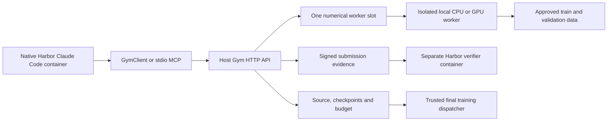

# Gym design

[中文](DESIGN.zh-CN.md) · [Usage and API](README.md#gym-api)

This document defines the architecture, responsibilities and limits of the repository's Gym. The usage document defines commands, API parameters and candidate inputs.
Harbor and the shared NextTransformer scientific code remain unchanged.

## Architecture and responsibilities

Harbor 0.24.0 and task schema 1.4 control containers, native Claude Code, trajectories and artifact collection.
Gym runs on the host and controls experiments, resources, data, retained source and budgets.
Gym adds no Agent subclass, model broker or separate reasoning loop. Agent collaboration does not change the session budget or numerical concurrency.

The Agent has shell tools and internet access inside its container.
Gym supplies historical results, model configurations and approved source references without a repository checkout or Git access.
Historical records distinguish current reference code from the code of a published experiment.
Each session can read only its own private experiments.

## HTTP and MCP

HTTP defines the interface through authenticated JSON calls to `POST /v1/call`.
`describe_space.operation_schemas` defines the operations and input schemas.
HTTP checks input schemas, permissions and budget rules before it executes an operation.
The Python client only handles transport and imports no training code.

The stdio MCP adapter reads these schemas and forwards calls through the same client.
SDK and MCP share credentials, results, errors, jobs and idempotency rules.
MCP adds no scheduler, budget account or HTTP listener. Harbor registers MCP through its native Claude Code integration.
The [usage document](README.md#gym-api) lists the API and candidate formats.

## Trial lifecycle and state

Each trial starts a separate host service with private state and separate Agent and verifier credentials.
The Agent mounts only its credential directory and a directory for signed evidence, both read-only.
The Agent receives no repository, training state, checkpoint root, GPU device, verifier credential or Docker socket.
The independent verifier mounts only its credential and has no network access.

The host listener binds port 0 on the Docker bridge address by default.
The operating system selects a free port, and Gym retains the bound socket.
Gym saves that port in the service state and reuses it after a restart.
A port conflict causes an explicit error. The listener file saves the port, not the bind address.

At Agent exit, a Harbor hook stops research, settles numerical work and signs evidence from the live service.
Harbor collects that evidence and a snapshot of the Agent container's actual processes before verification.
Host state remains after the trial ends. A new trial creates separate state and a new listener.
The launcher is not a persistent service manager for multiple tenants.

## Data and feedback

| Set | Data | Research access |
| --- | --- | --- |
| Train | Ordered ClimbMix prefix through shard 06541 at full scale | Gym training |
| Validation | Last shard, `shard_06542.parquet`, matching native defaults | Feedback for algorithm selection |
| Test | CORE-22 | New-candidate scores only after freezing and fresh final training |

Operators fix manifests, shard order, tokenizer and execution profiles before research.
The adapter refuses an exhausted training prefix. Existing `dev_path`, `dev_batches` and `dev_bpb` names refer to research validation.
Both `val` and the legacy `dev` alias use the native validation split.

Shipped profiles use labelled synthetic fixtures, not production ClimbMix data.
Final ranking uses only CORE-22. Training and validation metrics remain diagnostics.
Historical CORE results and public web information remain accessible.
The boundary restricts new-candidate feedback, not prior knowledge of the public benchmark.

## Native candidates and isolation

The `reference_plugin_v1` contract preserves native plugin source, metadata and local Python modules.
Native hooks include `model`, `mixer`, `ffn` and `block`. A `model` hook subclasses `ReferenceLM`.
Gym uses the native loader without an expression language or source translation.

`architecture.json` contains native `ModelConfig` fields and declared plugin options.
Profiles fix protocol values, including width, heads, context, vocabulary and scale.
Explicit candidate values must match those constraints.
Gym rejects optimizer settings, data paths and command overrides as architecture fields.
Upload checks metadata and field types without importing candidate code.
Workers check imports, native semantics, shapes and numerical behavior.

Packages contain at most 1 MiB and 32 text files inside the permitted layout.
Gym rejects traversal, symlinks, duplicate paths, runtime shadowing, binaries, weights and dependency installers.
Each session can retain at most 128 candidates. Changing source or configuration creates a new immutable candidate.

The operator selects the research worker isolation backend. Gym never switches backends automatically.
The default `bwrap` backend uses fresh bubblewrap user, mount, PID and network namespaces.
The `landlock` backend serves hosts that deny mounts. It requires a root controller, so workers run as a separate user.
It combines Landlock path rules with user, network, IPC and UTS namespaces. CPU workers also get a PID namespace and a seccomp filter against new Unix sockets.
The `none` backend disables isolation for trusted candidates. Gym prints a warning when it starts with this backend.
Isolated workers can read only runtime libraries, platform code, approved data and the current job's checkpoint/output.
Isolated workers cannot read controller state or credentials and have no host networking. CPU inspection receives no GPU devices.
Under `bwrap`, CUDA workers receive the selected NVIDIA device, required control/UVM devices and read-only driver metadata with a private PID procfs.
Under `landlock`, workers can detect path existence, list directories under the import roots and change file metadata.
CUDA workers keep the host PID namespace, can create Unix sockets and can open every NVIDIA device node.

## Resources and concurrency

The supported scope is one local machine and one concurrent numerical job per service state.
All sessions in that state share the worker slot, including jobs with uncertain outcomes.
Separate states do not share a machine-wide scheduler lock.
Operators run one research trial at a time to enforce the agreed scope.
Remote dispatch and parallel numerical workers are outside this scope.

The operator controls GPU allocation, memory limits and the CUDA Python environment.
The launcher converts GPU indices to stable UUIDs and saves the execution policy.
The Agent can inspect resources and choose an authorized local GPU and an absolute target update within profile limits.
The Agent cannot change the trainer or submit shell commands, environment overrides, data paths or SSH jobs to Gym.
Resource reports distinguish discovered, allocated and available devices, with reasons for unavailable capacity.

A busy GPU leaves work queued with its budget reservation and no numerical charge or CPU fallback.
Cooperative leases are local GPU locks for participating Gym processes under the same host user. The leases do not control unrelated applications.

By default, any compute or graphics process blocks dispatch.
Operator-only `allow_idle_graphics` permits graphics processes only with zero observed utilization, no compute process and sufficient memory.
Lease checks still apply, and unknown process observations block dispatch.
Memory admission bounds and the PyTorch allocator cap do not create a hardware partition.
These controls do not guarantee a limit on arbitrary direct CUDA allocations.
Results record actual parameter devices, runtime versions and peak GPU memory.

## Budget, checkpoints and failures

One fixed research allocation covers numerical checks and experiments. FLOPs count floating-point operations.
Agent inference, web search and local shell CPU use separate Harbor or provider limits.
Static shape audits consume no numerical research FLOPs. A quote binds source, profile, runtime, checkpoint, placement and absolute target update.
It expires after five minutes and permits one execution.

Gym reserves the quoted bound and creates the job in one SQLite transaction. FLOPs values cross the interface as decimal strings.
Each numerical operation needs a durable intent and controller acknowledgement before execution.
The worker reports completion with a unique charge identity.

Known numerical failures consume the current operation's conservative bound and report `numerical_failure`.
Cancellation stops at a reconciled numerical boundary.
Allocation exhaustion stops work, and final allocation exhaustion reports `budget_stopped`.

Unknown worker failures retain their reservations in `reconciliation`.
After the operator checks that the worker stopped, recovery charges the remaining conservative bound and marks the job failed.
Recovery refuses a still-owned worker slot, and retries do not charge twice.
The confirmation flag does not kill a process, and unknown work receives no refund.

Checkpoints retain model, optimizer, random-number generator (RNG), routing, data-buffer, schedule, stage and cumulative training state.
Continuation checks hashes and exact candidate, profile and runtime identities.
Trusted code computes validation metrics from predictions and labels rather than candidate-supplied scores.
Restarts require the frozen execution policy, profiles, source revision, worker Python, server ID and original bind address. Checkpoint cleanup remains manual.

## Admission, finalization and final training

Upload acceptance does not establish admission, and successful job execution does not establish that its checks passed.
Full validation reports determine admission for the exact candidate and profile. Partial diagnostics never replace full validation.
`finalize` requires final admission, a reconciled account and no active jobs, then freezes one candidate.

The final receipt contains `session_id`, `submission_id` and `candidate_hash`.
Gym retains the complete source and configuration, so final training does not require the Agent workspace or an exported archive.
The independent verifier checks HMAC-authenticated evidence and the trial binding.
Reward 1 means valid delivery, not model quality, and neither finalization nor verification starts training.

Trusted preparation creates a separate Git snapshot and preserves the native plugin. It audits admission without changing the source repository or starting training.
Trusted final dispatch requires a verified submission and a separate finite allocation, then starts from fresh initialization.
Dispatch rejects changes to the admitted final profile after submission.
It never reuses research checkpoints.

The native formal adapter uses 8, 16 or 32 allocated GPUs on one node, file rendezvous and exact rational charge rates.
Each rank receives a finite allocation share, and abnormal termination does not refund uncertain work.
Only a successful native audit/export can produce an official-compatible record, and upstream publication remains a separate process.

For a final profile with an `official_plan`, bounded diagnostics use one allocated GPU.
The memory cap is the smaller of the profile and execution-policy limits. Synthetic final profiles can use CPU.
These diagnostics do not change the frozen formal plan, device list or profile identity. Research experiments cannot use a final profile.

## Trust boundary and production acceptance

Static audits trace the selected native execution, not every data-dependent branch.
Native Python shares a process with accounting and scoring code.
Namespace isolation does not prove protection against malicious monkeypatching, forged worker messages or hidden computation.
The current path assumes code that follows the protocol.
Accounting for arbitrary adversarial Python requires an additional trust boundary before production use.

Maintained checks cover HTTP/MCP behavior, native compatibility, budgets, continuation, isolation and signed verification.
Production acceptance still requires reviewed ClimbMix/tokenizer manifests, CUDA/runtime parity, resource quotas, final admission, explicit final dispatch and full CORE-22 evaluation.
Fixtures keep formal BPB, CORE and rank null. Development tests do not run the full 49.152B-token protocol or establish production benchmark performance.
