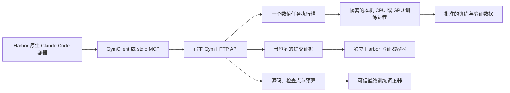

# Gym 设计

[English](DESIGN.md) · [使用与 API](README.zh-CN.md#gym-api)

本文定义仓库内 Gym 的架构、职责与限制。使用文档说明命令、API 参数和候选输入。
Harbor 和 NextTransformer 共享科研代码保持不变。

## 架构与职责

Harbor 0.24.0 和任务格式 1.4 管理容器、原生 Claude Code、轨迹与交付物收集。
Gym 在宿主机运行，管理实验、资源、数据、留存源码与预算。
Gym 不增加 Agent 子类、模型代理或独立推理循环。Agent 协作不改变会话预算或数值任务并发限制。

Agent 可以在容器内使用 shell 工具和互联网。
Gym 提供历史结果、模型配置和批准的源码参考，不需要检出仓库或访问 Git。
历史记录区分当前参考代码与已发布实验当时的代码。
每个会话只能读取自己的私有实验。

## HTTP 与 MCP

HTTP 通过经过身份认证的 JSON `POST /v1/call` 定义接口。
`describe_space.operation_schemas` 定义操作及输入 schema。
HTTP 在执行操作前检查输入 schema、权限和预算规则。
Python 客户端只负责传输，不导入训练代码。

stdio MCP 适配器读取这些 schema，并通过同一个客户端转发调用。
SDK 与 MCP 共用凭据、结果、错误、任务及幂等规则。
MCP 不增加调度器、预算账户或 HTTP 监听服务。Harbor 通过原生 Claude Code 集成注册 MCP。
[使用文档](README.zh-CN.md#gym-api) 列出 API 与候选格式。

## 任务生命周期与状态

每个研究任务（trial）启动一个独立宿主服务，使用私有状态及相互独立的 Agent、验证器凭据。
Agent 只挂载自己的凭据目录和签名证据目录，两者均为只读。
Agent 不接收仓库、训练状态、检查点根目录、GPU 设备、验证器凭据或 Docker socket。
独立验证器 只挂载自己的凭据，不能访问网络。

宿主监听服务默认在 Docker 网桥地址绑定端口 0。
操作系统分配空闲端口，Gym 保持该 socket 的绑定。
Gym 将端口保存到服务状态，并在重启后复用。
端口冲突会明确报错。监听配置文件只保存端口，不保存绑定地址。

Agent 结束时，Harbor hook 停止研究、结算数值任务，并由当前服务生成签名证据。
Harbor 在验证前收集证据，以及 Agent 容器内真实进程状态的快照。
trial 结束后保留宿主状态。新 trial 创建独立状态和新的监听服务。
启动器不是面向多个租户的常驻服务管理器。

## 数据与反馈

| 集合 | 数据 | 研究阶段访问方式 |
| --- | --- | --- |
| 训练集 | 完整规模下，按顺序排列且截至分片 06541 的 ClimbMix 前缀 | 通过 Gym 训练 |
| 验证集 | 最后一个分片 `shard_06542.parquet`，与原生默认设置一致 | 提供算法选择反馈 |
| 测试集 | CORE-22 | 新候选仅在冻结并从头完成最终训练后获得分数 |

管理员在研究前固定数据清单、分片顺序、tokenizer 和执行 profile。
训练前缀耗尽后，适配器拒绝继续读取。现有 `dev_path`、`dev_batches` 和 `dev_bpb` 名称表示研究验证数据及反馈。
`val` 与旧别名 `dev` 都使用原生验证集划分。

随附 profile 使用明确标注的合成测试数据，不是生产 ClimbMix 数据。
最终排名只使用 CORE-22。训练与验证指标仍是诊断信息。
已发布的历史 CORE 结果和公开网络信息仍可访问。
该边界限制新候选获得的反馈，不保证 Agent 从未接触公开基准。

## 原生候选与隔离

`reference_plugin_v1` 契约保留原生插件源码、元数据和本地 Python 模块。
原生 hook 包括 `model`、`mixer`、`ffn` 和 `block`。`model` hook 必须继承 `ReferenceLM`。
Gym 使用原生加载器，不引入表达式语言或源码转换。

`architecture.json` 包含原生 `ModelConfig` 字段及插件声明的 options。
执行配置（profile）固定协议值，包括宽度、注意力头数、上下文、词表与 scale。
候选显式提供的值必须符合这些约束。
Gym 拒绝将优化器设置、数据路径或命令覆盖项作为架构字段。
上传阶段检查元数据与字段类型，不导入候选代码。
训练进程（worker）检查导入、原生语义、形状和数值行为。

候选包在允许的目录结构内最多包含 1 MiB、32 个文本文件。
Gym 拒绝路径穿越、符号链接、重复路径、运行时覆盖、二进制文件、权重及依赖安装器。
每个会话最多保留 128 个候选。源码或配置变化会创建新的不可变候选。

运维选择研究 worker 的隔离后端。Gym 不会自动切换后端。
默认的 `bwrap` 后端使用新的 bubblewrap 用户、挂载、PID 和网络命名空间。
`landlock` 后端用于禁止挂载的宿主机。它要求控制器以 root 运行，使 worker 以独立用户运行。
它结合 Landlock 路径规则与用户、网络、IPC 和 UTS 命名空间。CPU worker 另有 PID 命名空间和禁止新建 Unix socket 的 seccomp 过滤器。
`none` 后端关闭隔离，仅用于可信候选。使用该后端启动时，Gym 打印警告。
隔离的 worker 只能读取运行时库、平台代码、批准的数据及当前任务的检查点和输出。
隔离的 worker 不能读取控制器状态或凭据，也没有宿主网络。CPU 检查不接收 GPU 设备。
在 `bwrap` 下，CUDA worker 接收选定的 NVIDIA 设备、必要的控制/UVM 设备和只读驱动元数据，并使用私有 PID procfs。
在 `landlock` 下，worker 能判断路径是否存在、列出导入根目录下的目录，并能修改文件元数据。
CUDA worker 保留宿主 PID 命名空间，能创建 Unix socket，并能打开所有 NVIDIA 设备节点。

## 资源与并发

支持范围是一台本机，每个服务状态最多并发执行一个数值任务。
该状态下所有会话共用执行槽，结果不确定的任务也会占用执行槽。
不同服务状态不共享整机调度锁。
管理员同时只运行一个研究 trial，才能满足约定的范围。
远程调度与并行数值 worker 不在支持范围内。

管理员控制 GPU 分配、内存限制和 CUDA Python 环境。
启动器将 GPU 序号转换为稳定的 UUID，并保存执行策略。
Agent 可以查看资源，并在 profile 限制内选择获准的本机 GPU 和绝对目标步数。
Agent 不能更换 trainer，也不能向 Gym 提交 shell 命令、环境覆盖项、数据路径或 SSH 任务。
资源报告区分已发现、已分配及当前可用的设备，并说明不可用原因。

GPU 忙碌时，任务保留预算预留并排队，不收取数值计算费用，也不回退到 CPU。
协作租约是同一宿主用户下、参与协作的 Gym 进程共用的本机 GPU 锁。租约不控制其他应用。

默认情况下，任何计算或图形进程都会阻止调度。
仅管理员可设置的 `allow_idle_graphics` 允许存在图形进程，但要求观测利用率为零、没有计算进程且可用内存充足。
租约检查仍然适用，未知进程观测结果会阻止调度。
内存准入上界和 PyTorch 分配器上限不构成硬件分区。
这些控制不能保证限制任意直接 CUDA 内存分配。
结果记录参数实际所在设备、运行时版本及 GPU 峰值内存。

## 预算、检查点与失败处理

一个固定研究额度覆盖数值检查和实验。FLOPs 表示浮点运算次数。
Agent 推理、网络搜索及本地 shell CPU 使用独立的 Harbor 或供应商限制。
静态形状审计不消耗数值研究 FLOPs。报价绑定源码、profile、运行时、检查点、执行位置及绝对目标步数。
报价五分钟后过期，并且只能执行一次。

Gym 在同一个 SQLite 事务中预留报价上界并创建任务。接口使用十进制字符串表示 FLOPs。
每次执行数值操作前，必须持久化操作意图，并获得控制器确认。
worker 使用唯一计费标识报告完成状态。

已知数值失败消耗当前操作的保守上界，并报告 `numerical_failure`。
取消操作在完成结算的数值边界停止执行。
额度耗尽后停止工作，最终训练额度耗尽时报告 `budget_stopped`。

未知 worker 失败保留预算预留，并进入 `reconciliation`。
管理员检查 worker 已停止后，恢复操作扣除剩余保守预留并将任务标为失败。
恢复操作拒绝处理仍有 worker 占用的执行槽，重复请求不会重复扣费。
确认标记不会终止进程，未知工作量也不会获得退款。

检查点保留模型、优化器、随机数生成器（RNG）、路由、数据缓冲、调度、阶段及累计训练状态。
续训检查哈希，以及候选、profile、运行时身份的精确匹配。
可信代码根据预测和标签计算验证指标，不接受候选直接提供的分数。
重启需要冻结的执行策略、profile、源码版本、worker Python、服务器 ID 和原绑定地址。检查点仍需手动清理。

## 准入、冻结与最终训练

上传成功不代表通过准入，任务执行成功也不代表其检查通过。
完整验证报告决定精确候选与 profile 的准入结果。局部诊断不能替代完整验证。
`finalize` 要求通过最终准入、账户完成结算且没有活动任务，随后冻结一个候选。

最终回执包含 `session_id`、`submission_id` 和 `candidate_hash`。
Gym 保留完整源码和配置，因此最终训练不依赖 Agent 工作区或另行导出的归档。
独立验证器 检查经过 HMAC 认证的证据及 trial 绑定关系。
reward 为 1 仅表示交付有效，不表示模型质量。冻结和验证都不会启动训练。

可信准备流程创建独立 Git 快照并保留原生插件。它审计准入，不修改源仓库，也不启动训练。
可信最终调度要求已验证的提交和独立的有限额度，随后从全新初始化开始训练。
提交后，如果通过准入的最终 profile 发生变化，调度器会拒绝启动。
最终训练不复用研究检查点。

原生正式适配器在单节点使用 8、16 或 32 张已分配 GPU，通过文件协调训练进程，并使用精确分数计算费用。
每个 rank 获得有限的额度份额，异常结束不会退还不确定工作量的费用。
只有成功的原生审计和导出才能产生兼容官方协议的记录，上游发布仍是独立流程。

如果最终 profile 包含 `official_plan`，受限诊断只使用一张已分配 GPU。
内存上限取 profile 和执行策略上限的较小值。合成数据的最终 profile 可以使用 CPU。
这些诊断不改变冻结的正式计划、设备列表或 profile 身份。研究实验不能使用最终 profile。

## 信任边界与生产验收

静态审计追踪所选原生执行路径，不覆盖所有依赖数据的分支。
原生 Python 与计费、评分代码共享进程。
命名空间隔离不能证明系统能够抵御恶意 monkeypatch、伪造 worker 消息或隐藏计算。
当前路径假设代码遵循协议。
若要对任意恶意 Python 代码计费，生产使用前还需要额外的信任边界。

维护中的检查覆盖 HTTP/MCP 行为、原生兼容性、预算、续训、隔离和签名验证。
生产验收仍需审核 ClimbMix/tokenizer 清单、CUDA/运行时一致性、资源配额、最终准入、显式最终调度和完整 CORE-22 评估。
测试夹具的正式 BPB、CORE 和排名保持 null。开发测试不运行完整的 49.152B-token 协议，也不证明生产基准表现。
